# 3D Improved U-Net for Prostate Radiotherapy Contouring (HipMRI 3D)

**Author:** Yogesh Sevda (s49116889) · COMP3710 Pattern Analysis Project · **Difficulty: Hard** (3D Improved U-Net, Section 2.2)

---

## 1. Problem and algorithm

### The problem
Before a prostate cancer patient starts external-beam radiotherapy, someone has to outline the
prostate (the treatment target) and the organs around it that need protecting, such as the bladder,
rectum and bones, on every slice of a pelvic MRI. Doing this by hand is slow, and different clinicians
draw slightly different outlines. A model that produces a good first draft, which a planner then checks
and corrects, could save a lot of that time.

The catch is where the mistakes happen. Most of the prostate is easy to see, but at its two ends, the
**apex** (bottom) and the **base** (top, where it meets the bladder), the gland gets small and its border
with the bladder and rectum is hard to make out. Drawing too much there sends radiation into healthy
bladder or rectal wall; drawing too little risks missing tumour. So a draft is only useful if it is
reliable at the ends, not just in the middle.

This project segments 6 classes (background, body, bone, bladder, rectum, prostate) in 3D MRI volumes
from the HipMRI prostate study: 211 scans from 38 patients.

### The engineering dilemma
A 2D network looks at one slice at a time. It is cheap and fast, but it has no idea what is on the
slices above and below, so its outlines can jump around between slices, especially near the ends of
the prostate. A 3D network sees the whole volume at once, but needs more memory and compute.

The question I set out to answer is: **does real 3D context actually fix the apex and base errors that
a 2D model makes, or does it just tidy up the easy middle slices at a much higher cost?** To answer it,
I trained a 3D Improved U-Net and a 2D U-Net baseline on exactly the same data and compared them
overall, per organ, and specifically on the slices at the ends of the prostate.

### How the 3D Improved U-Net works
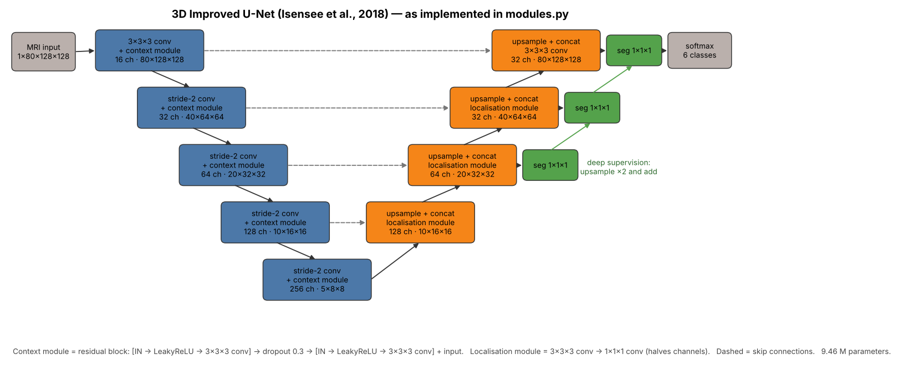

The model follows Isensee et al. (2018). Like any U-Net, it has an encoder that shrinks the volume to
work out *what* is in it, and a decoder that grows it back to work out *where* the boundaries are:

* **Encoder (left side).** Five levels with 16 → 256 feature maps. Each level halves the volume size
  with a stride-2 3×3×3 convolution and then applies a **context module**, a residual block
  (instance norm → LeakyReLU → conv → dropout → instance norm → LeakyReLU → conv, plus the input).
  The deeper the level, the larger the 3D neighbourhood each feature summarises, including several
  slices above and below. That through-plane context is exactly what a 2D model never gets.

* **Decoder (right side).** Each level upsamples ×2, **concatenates the matching encoder features**
  (skip connection, which restores fine boundary detail lost when downsampling), and recombines them
  with a **localisation module** (3×3×3 conv then 1×1×1 conv).

* **Deep supervision.** Small 1×1×1 segmentation layers on three decoder levels are upsampled and
  added into the final output, so the coarser levels get feedback directly and train faster.

* **Output.** 6-channel logits per voxel; softmax/argmax gives the label map.

**Baseline:** a standard 2D U-Net (Ronneberger et al., 2015), 4 pooling levels, 32 → 512 feature maps,
run on each axial slice and stacked back into a volume. At 7.76 M parameters it is close in size to
the 3D model (9.46 M), so any difference between them comes from 3D context rather than one model
simply being bigger.

**Loss (both models):** 0.5 × soft Dice + 0.5 × cross-entropy. The prostate is only 0.08 % of all
voxels (Section 4), so with cross-entropy alone the background would dominate training. The Dice term
is averaged per class, which gives the prostate the same weight as the much larger classes.

---

## 2. Feasibility review (one page)

_The one-page review presented to my tutor for the compulsory check-off, written before the full training runs. Results are in Section 6._

**3D Improved U-Net for Prostate Contouring (HipMRI 3D), Hard difficulty**

### 2.1 Who this is for and what success looks like
The user I have in mind is a radiotherapy planner who has to outline the prostate, bladder and rectum on every slice of a pelvic MRI before treatment. My prototype would give them a first-draft contour to check and correct, not a final one. The question I want to answer is the one raised in the brief. A 2D U-Net segments each slice on its own, so it tends to go wrong at the base and apex of the prostate, where the gland is small and its border with the bladder and rectum is unclear. Does giving the network real 3D context fix those errors, or does it mostly tidy up the easy middle slices while costing a lot more GPU memory?

I will count the prototype as successful if:

* every label, including the prostate, reaches a test Dice of at least 0.7 on patients the model has never seen;
* I can report per-label Dice and IoU for both my model and a 2D baseline on exactly the same test patients;
* I measure prostate Dice separately on the base/apex slices and the central slices, and diagnose 3–5 real failure cases;
* both models train and run on a single Rangpur A100, and I report peak VRAM, parameter count and inference time per volume.

### 2.2 Model choice and why
I am using the HipMRI 3D data (`semantic_MRs` and `semantic_labels_only`): 211 volumes from 38 patients, with six classes (background, body, bone, bladder, rectum, prostate). My main model is the 3D Improved U-Net from Isensee et al. (2018), which adds residual context modules and deep supervision to the standard U-Net. My baseline is a plain 2D U-Net (Ronneberger et al., 2015), run slice by slice on the same volumes and stacked back together. That way both models see identical data, and the only real difference between them is 2D versus 3D. The link to the course is receptive fields: a 3D kernel sees the slices above and below, which a 2D kernel never can, while the skip connections carry fine boundary detail across the network. Because the prostate is such a small part of each volume, I will train with soft Dice plus cross-entropy rather than cross-entropy alone.

### 2.3 What I have checked so far
I audited the data on Rangpur: 211 MR volumes and 211 label volumes that pair one to one by filename (for example `B006_Week0`), 38 patients, volumes of 256 × 256 × 128 or 144 voxels at about 1.56 mm, and label values 0–5. I then preprocessed all 211 volumes (normalise, pad to 160 slices, downsample to 80 × 128 × 128) and built the patient-level split: 26 patients for training, 6 for validation and 6 for testing. This run also showed how imbalanced the task is. The prostate makes up only 0.08 % of all voxels, the rectum 0.12 % and the bladder 0.46 %.

### 2.4 Risks, budget and plan B
The biggest risk is data leakage. Each patient was scanned in several different weeks, so I split by patient rather than by scan, and the code checks that no patient appears in two splits. The next risk is GPU memory for a 3D model. Downsampling, a batch size of 1–2 and mixed precision should keep it well within one A100, with patch-based training as a backup. If the prostate Dice falls short of 0.7, I will lean on the Dice loss, augmentation (flips, small rotations, intensity changes) and deep supervision. I expect to need about 10 GPU-hours in total. My next step is to train both models on the same split and compare them overall and on the base/apex slices. If the Improved U-Net doesn't work out in time, my fallback is a standard 3D U-Net (Normal difficulty), which uses the same pipeline.

---

## 3. Repository structure and usage

| File | Purpose |
|---|---|
| `modules.py` | `ImprovedUNet3D`, `UNet2D` baseline, `DiceCELoss` (PyTorch only) |
| `dataset.py` | NIfTI loading, preprocessing + cache, patient-level split, augmentation, 3D/2D `Dataset`s |
| `train.py` | training, validation, checkpointing, testing, loss/Dice plots, metrics JSON |
| `utils.py` | volumetric Dice/IoU, prostate extremity-vs-central Dice, inference helpers |
| `predict.py` | loads trained weights, runs the test set, writes figures and results tables |
| `slurm/*.slurm` | Rangpur batch scripts for training and prediction |

### Dependencies
Exact versions used for all reported results (Rangpur `torch` conda environment):

| Package | Version | Used for |
|---|---|---|
| Python | 3.11.16 | |
| PyTorch | 2.14.0 (CUDA 13.0 build) | models, training, augmentation, metrics |
| nibabel | 5.4.2 | reading NIfTI volumes (`dataset.py` only) |
| NumPy | 2.4.6 | NIfTI → tensor conversion, plotting (not used in `modules.py`) |
| matplotlib | 3.11.1 | training curves and figures |

Install into a fresh environment with `pip install -r requirements.txt` (pins the versions above).

Hardware: Rangpur, 1 × NVIDIA A100-PCIE-40GB per job.

### Reproducing the results
```bash
# on Rangpur, inside recognition/ImprovedUNet3D_s49116889 with the conda env active
python dataset.py                 # one-off: preprocess 211 volumes to ~/hipmri_cache (≈0.8 GB)
sbatch slurm/train_3d.slurm       # 3D Improved U-Net -> runs/3d/
sbatch slurm/train_2d.slurm       # 2D U-Net baseline -> runs/2d/
sbatch slurm/predict.slurm        # test-set inference + figures -> figures/
```
Trained weights (`runs/<model>/best.pt`, ≈40 MB each) are deliberately **not committed**, as the brief
requires; the commands above regenerate them in about 50 minutes of A100 time.
`python train.py --model 3d --quick` runs a 2-epoch smoke test. All randomness is seeded (`--seed 42`):
the patient split is fully deterministic; training results may vary slightly between runs because of
non-deterministic GPU kernels.

---

## 4. Data, preprocessing and splits

**Raw data.** `B006_Week0_LFOV.nii.gz` (MRI) pairs with `B006_Week0_SEMANTIC.nii.gz` (labels): patient
`B006`, scanned at week 0. Volumes are 256 × 256 × 128 or 256 × 256 × 144 voxels at ≈1.56 mm isotropic.

**Preprocessing** (`dataset.preprocess_case`, run once and cached):

1. **z-score normalisation** per volume, so that brightness differences between scans don't matter.
2. **Pad the slice axis to 160** (with the volume's minimum intensity / background label) so both volume
   sizes share one shape **without cropping any anatomy**.
3. **Downsample ×2 in every axis → 80 × 128 × 128 voxels (≈3.1 mm)**: average pooling for images
   (anti-aliased), nearest-neighbour for labels (class values are never blended). This keeps a whole
   volume plus activations comfortably within GPU memory and makes all dimensions divisible by 16 for
   the four downsampling steps.
4. **Augmentation (training only):** random left–right flip, random in-plane rotation (±10°) and
   scaling (0.9–1.1) for 3D volumes, random intensity scale/shift (±10 %).

**Class balance after preprocessing** (all 211 volumes):

| Class | background | body | bone | bladder | rectum | prostate |
|---|---|---|---|---|---|---|
| % of voxels | 68.48 | 28.18 | 2.68 | 0.46 | 0.115 | **0.080** |

**Patient-level split** (`dataset.patient_split`, seed 42):

| Split | Patients | Volumes |
|---|---|---|
| Train | 26 | 136 |
| Validation | 6 | 48 |
| Test | 6 | 27 |

Each patient was scanned several times (different weeks), and those scans are nearly identical
anatomically. Splitting **by patient** guarantees the test set contains only people the model has never
seen; splitting by volume or slice would leak the same anatomy into training and inflate test scores.
The split is checked with assertions in code and saved to `runs/<model>/split.json`. Validation (mean
foreground Dice) selects the checkpoint; the test set is used once, at the end.

---

## 5. Training configuration

| | 3D Improved U-Net | 2D U-Net baseline |
|---|---|---|
| Input | whole volume 1 × 80 × 128 × 128 | axial slice 1 × 128 × 128 (all 80 per volume) |
| Batch size | 2 volumes | 32 slices |
| Epochs | 200 (validate every 5) | 40 (validate every epoch) |
| Optimiser | Adam, lr 5e-4, weight decay 1e-5, cosine decay | Adam, lr 1e-3, weight decay 1e-5, cosine decay |
| Precision | bfloat16 mixed precision | bfloat16 mixed precision |
| Model selection | best validation mean foreground Dice → epoch **120** (val 0.918) | same → epoch **33** (val 0.896) |

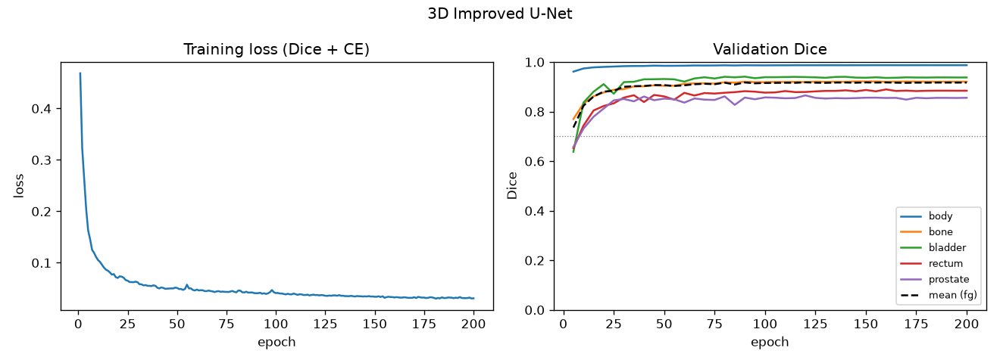
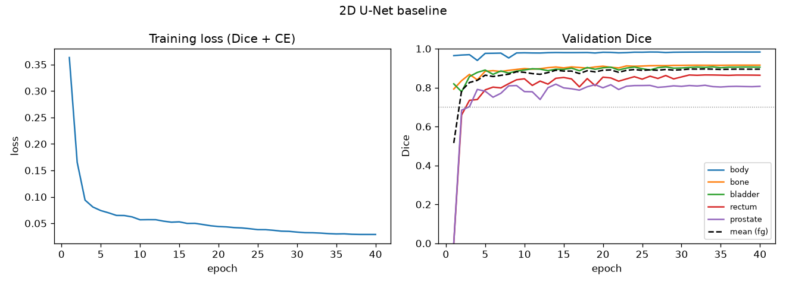

Both models trained smoothly. Validation Dice levels off rather than dropping while the training loss
keeps creeping down, so there is no clear sign of over-fitting. The 3D model's validation prostate Dice
settles around 0.85–0.86. The 2D model's settles lower, around 0.80–0.81, and jumps around more from
epoch to epoch, which was an early hint that slice-by-slice prediction is less stable on the prostate.

---

## 6. Results

All numbers are on the **held-out test set: 6 patients never seen in training or model selection
(27 volumes)**. Dice/IoU are computed on whole 3D volumes for both models.

### 6.1 Segmentation accuracy per class

| Class | 3D Improved U-Net Dice | 3D IoU | 2D U-Net Dice | 2D IoU | 3D better in |
|---|---|---|---|---|---|
| background | 0.999 | 0.998 | 0.998 | 0.995 | – |
| body | 0.988 | 0.977 | 0.985 | 0.970 | 22 / 27 volumes |
| bone | 0.929 | 0.868 | 0.925 | 0.861 | 26 / 27 |
| bladder | 0.952 | 0.910 | 0.950 | 0.906 | 18 / 27 |
| rectum | 0.864 | 0.764 | 0.855 | 0.753 | 15 / 27 |
| **prostate** | **0.870** | **0.773** | 0.822 | 0.700 | **26 / 27** |
| foreground mean | **0.921** | | 0.907 | | |

Every label clears the 0.7 Dice target for both models (acceptance criterion a).

The large, high-contrast structures (body, bone, bladder) are handled well by either model, and the
differences there are 0.004 Dice or less. The real gap is on the **prostate: +0.048 Dice and +0.073
IoU** for the 3D model. It wins on 26 of the 27 test volumes and on all 6 test patients. Per-patient
mean prostate Dice, 3D vs 2D:

| Patient | J026 | K008 | S028 | T009 | T014 | V027 |
|---|---|---|---|---|---|---|
| 3D Improved U-Net | 0.883 | 0.826 | 0.887 | 0.906 | 0.828 | 0.899 |
| 2D U-Net | 0.827 | 0.815 | 0.818 | 0.884 | 0.781 | 0.853 |

Looking at the worst single volumes as well as the averages: the 3D model's lowest prostate Dice is
0.783 (2D: 0.734), and its worst rectum volume (0.699) is still better than the 2D model's (0.607). The
bladder is the one class where the 2D model has the better worst case (0.836 vs 0.776), which ties in
with failure type B in Section 7.

### 6.2 The dilemma: base/apex vs central prostate slices

| Prostate Dice on… | 3D Improved U-Net | 2D U-Net | 3D gain |
|---|---|---|---|
| extremity slices (outer 25 % at each end) | **0.840** | 0.778 | **+0.062** |
| central slices (middle 50 %) | 0.907 | 0.889 | +0.018 |

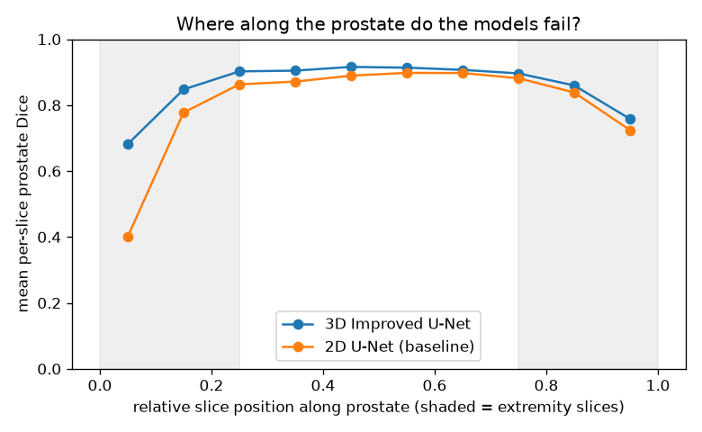

The plot shows the average per-slice prostate Dice at each position along the true prostate, from
its first slice (0) to its last (1). Slice index increases towards the bladder (in the coronal views in
6.4 the bladder sits above the prostate), so 0 is roughly the **apex** and 1 the **base**.

* Through the middle half of the gland both models score 0.86–0.92 and the two curves almost touch.
  Here, 3D context adds very little.
* At the apex the picture changes completely. In the last tenth of the gland the 2D model falls to
  **0.40**, while the 3D model holds **0.68**. This is the biggest difference I found anywhere.
* At the base both models drop (0.76 vs 0.72), and the 3D advantage is smaller.

So, to answer the question from Section 1: **3D context does reduce the risky errors at the ends of the
prostate, rather than just tidying up the easy middle slices.** Its gain at the extremities is about
3.5 times its gain in the centre. It does not remove those errors, though. Both models are still
clearly weaker at the ends of the gland than in the middle, and Section 7 looks at why.

### 6.3 Computational cost

| Resource (1 × A100-40GB) | 3D Improved U-Net | 2D U-Net | Ratio |
|---|---|---|---|
| Parameters | 9,462,722 | 7,762,630 | 1.2× |
| Peak training VRAM | 2.77 GB | 0.92 GB | 3.0× |
| Peak inference VRAM | 0.76 GB | 0.45 GB | 1.7× |
| Inference time per volume | 269 ms | 260 ms | 1.0× |
| Training time | 32 min | 15 min | 2.1× |

The brief warns that 3D models can cost "5–10× the GPU memory and training time". At this
resolution (80 × 128 × 128, about 3.1 mm voxels) the actual overhead was smaller: **3× the training
memory and 2× the training time, with no slowdown at inference**. One 3D pass over a volume costs about
the same as running the 2D model over its 80 slices. Both models would fit comfortably on an ordinary
consumer GPU.

### 6.4 Example predictions

Top row: axial slice through the centre of the prostate. Bottom row: coronal view through the same point
(superior is up), which shows how consistent each model is **across** slices.
Colours: body grey, bone white, bladder yellow, rectum brown, prostate red.

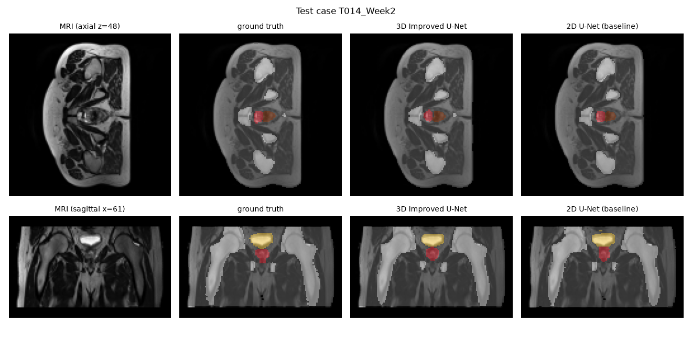
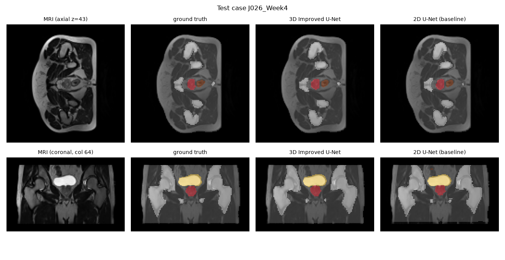
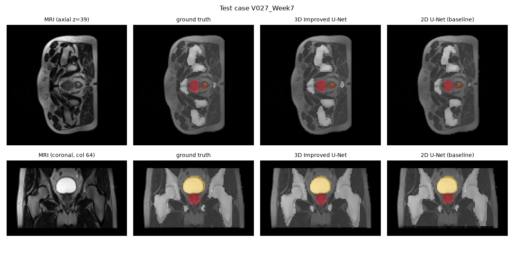

These are the 3D model's worst (T014_Week2, prostate Dice 0.783), median (J026_Week4, 0.881) and best
(V027_Week7, 0.925) test volumes. On the central axial slices the two models are almost impossible to
tell apart, which matches Section 6.2. The differences show up at the top and bottom of the gland in the
coronal views.

---

## 7. Failure case analysis

To choose the failure cases, `predict.py` ranks every axial slice that contains prostate (in either the
ground truth or the prediction) by the 3D model's per-slice prostate Dice. To avoid showing five
versions of the same mistake, it keeps at most one slice per test patient, and mixes slices inside the
true prostate (missed prostate) with slices outside it (extra prostate). Each figure shows the MRI, the
ground truth, the 3D prediction, the 2D prediction on the same slice, and the 3D model's errors
(red = false positive, blue = false negative).

| # | Slice | Position | 3D error | 3D slice Dice | 2D slice Dice | Type |
|---|---|---|---|---|---|---|
| 1 | K008_Week0 z=36 | first prostate slice (apex) | 32 voxels missed → body | 0.00 | 0.00 | A: apex under-segmentation |
| 2 | S028_Week0 z=49 | last prostate slice (base) | 38 voxels missed → **bladder** 33, body 5 | 0.00 | 0.10 | B: base–bladder confusion |
| 3 | T014_Week1 z=27 | first prostate slice (apex) | 19 voxels missed → body | 0.00 | 0.00 | A: apex under-segmentation |
| 4 | J026_Week0 z=30 | 1 slice below the true apex | 18 voxels of false prostate | 0.00 | – (none predicted) | C: apex over-extension |
| 5 | V027_Week1 z=35 | 1 slice below the true apex | 12 voxels of false prostate | 0.00 | – (none predicted) | C: apex over-extension |

**All five are at the first or last slice of the gland, or one slice beyond it. None is in the middle.**
This is exactly the pattern the brief's dilemma describes.

**Type A: missed apex (failures 1 and 3).** At its apex the prostate narrows to a tiny cross-section,
only 19–32 voxels (roughly 2–3 cm² at 3.1 mm resolution). It sits right against the rectum and the
pelvic-floor muscles, which look very similar on T2 MRI. Both models labelled it as body. I think three
things combine here. First, the ×2 downsampling blurs a structure that is only a few voxels wide
(partial-volume effect). Second, the contrast against the surrounding muscle is low. Third, the Dice
loss is dominated by the bulk of the gland, so a handful of apex voxels barely affects it. 3D context
can't help much either, because the slice below contains no prostate to "continue" from.

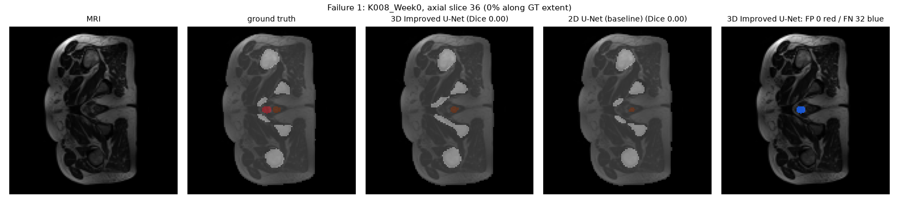
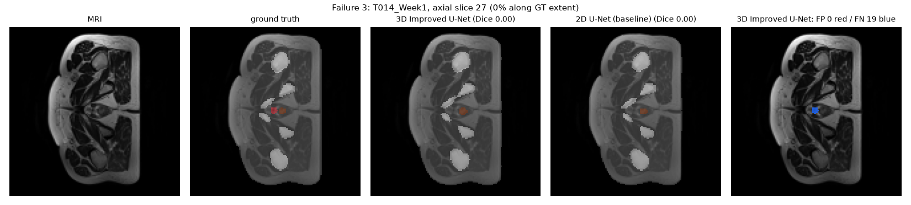

**Type B: base mistaken for bladder (failure 2).** On the last prostate slice, the base pushes up into
the bladder wall. The 3D model labelled 33 of the 38 missed voxels as bladder, and the 2D model only
caught a sliver (slice Dice 0.10). The likely cause is that, at 3.1 mm per slice, this slice mixes
prostate with the bright, fluid-filled bladder directly above it. The 3D model also sees a lot of
bladder in the slices above, which probably pushes its decision further towards bladder. Clinically
this is under-contouring the target, the error the brief links to a risk of tumour recurrence.

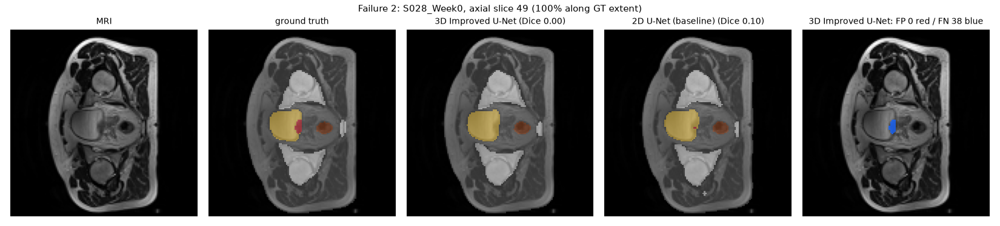

**Type C: apex drawn one slice too far (failures 4 and 5). This one is caused by 3D context.** Here the
3D model carries the prostate one slice past the true apex, as a small 12–18-voxel blob just in front of
the rectum, where the 2D model correctly predicts nothing. It is the flip side of seeing several slices
at once: the model has learnt that the gland continues smoothly between slices, and it sometimes
continues it one slice too far. One 3.1 mm slice is a small error, and the exact apex is hard to pin
down on MRI even for experts. The location still matters, though, because extra prostate next to the
rectum means over-contouring towards the rectal wall, which the brief links to radiation proctitis.

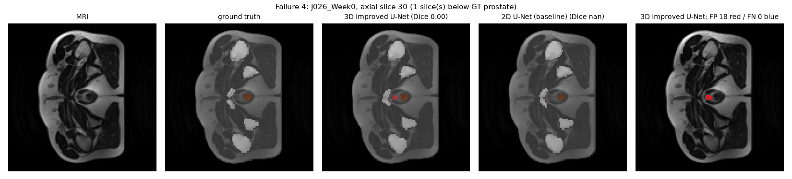
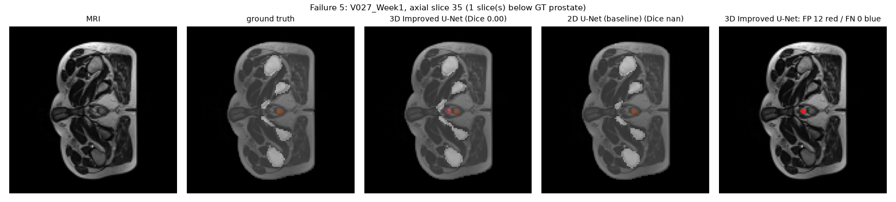

**Which cases are not suitable for automatic drafting?** The first and last one or two prostate slices
at both the apex and the base, the prostate–bladder border, and any small island of prostate next to the
rectum below the main gland.

---

## 8. Recommendation to the project manager

**My recommendation is to take the 3D Improved U-Net forward as a draft-contouring assistant, with a
human always reviewing the apex and base of the prostate. It is not ready to produce contours that
nobody checks.**

**Why the 3D model is worth the extra cost**

* It is more accurate on the treatment target: prostate Dice 0.870 vs 0.822, better on 26 of 27 volumes
  and on all 6 unseen patients, and no organ gets meaningfully worse.
* Its advantage is biggest exactly where the 2D model struggles: +0.062 Dice on the apex/base slices
  against +0.018 in the middle, and 0.68 vs 0.40 on the very last apex slices.
* The cost is modest: 3× the training memory (2.8 GB), twice the training time (32 min), and the same
  inference time (about 0.27 s per volume), so it would not slow down a clinical workflow.

**Why it should not run unsupervised**

* The ends of the prostate are still its weakest area (0.84 at the extremities vs 0.91 in the middle,
  0.68 at the very apex), and all five of the worst slices were there.
* It has two specific habits that matter clinically: it sometimes extends the apex towards the rectum
  (type C), and it can absorb the prostate base into the bladder (type B).

**How I would use it in the contouring pipeline**

1. Body, bone and bladder contours can be accepted after a quick check (all ≥ 0.92 Dice on unseen
   patients), paying attention to where the bladder meets the prostate.
2. For the prostate, accept the middle slices, but flag the first and last ~25 % of the predicted
   prostate, plus one slice beyond each end, for a mandatory review. That would have caught every
   failure I found.
3. Flag any piece of prostate touching the rectum below the main gland for explicit sign-off.

**What I would try next**

1. Train at the full 1.56 mm resolution using 3D patches, to go after the missed-apex failures (type A).
2. Add a boundary-focused loss term, or give extra weight to the extremity slices.
3. Repeat both models with at least three random seeds, so the gains come with confidence intervals.
4. Test on more patients. Six test patients (27 volumes, including repeat scans of the same people) is
   enough to show a consistent direction, but not to estimate how often rare failures happen.

**Acceptance criteria from the feasibility review**

| Criterion | Result |
|---|---|
| (a) Test Dice ≥ 0.7 on every label incl. prostate | ✅ lowest class mean: rectum 0.864, prostate 0.870 |
| (b) Per-label Dice + IoU for both models on identical test patients | ✅ Section 6.1 |
| (c) Extremity vs central prostate Dice + 3–5 diagnosed failures | ✅ Sections 6.2 and 7 |
| (d) Single A100, VRAM / parameters / inference time reported | ✅ Section 6.3 (max 2.8 GB) |

**Limitations.** Each model was trained once, so I can't yet say how much the numbers vary between runs.
The test set has only 6 patients, and the images were downsampled to about 3.1 mm voxels. The
ground-truth apex and base are also uncertain in themselves, so some one-slice disagreements there will
reflect how the annotator drew the boundary rather than a true model error.

---

## 9. Artificial Intelligence Usage Disclosure

**Tools used.** I used Anthropic's Claude (through the Claude app) throughout this project.

**What it helped with.**

* Reading the brief with me, choosing the project and model, and drafting the feasibility review.
* Writing the first versions of the code: `modules.py`, `dataset.py`, `utils.py`, `train.py`,
  `predict.py` and the Slurm scripts. It also ran small smoke tests of the scripts on synthetic data
  before I ran them on Rangpur.
* Debugging problems on Rangpur, such as `matplotlib` missing on the compute nodes, activating the conda
  environment inside Slurm jobs and checking the CUDA driver version, and helping with my Git workflow.
* Drafting this README, including the architecture diagram and much of the wording of the analysis.

**How I checked and verified it.**

* I ran the data audit on Rangpur myself (file names, 211 image/label pairs, 38 patients, volume shapes,
  voxel size and label values), and the loader was written to match what I found.
* I ran the preprocessing, both training jobs and the prediction job on Rangpur myself, and every number
  in this report comes from those runs. I checked the reported results against the training logs and
  the saved `test_metrics_*.json` files.
* I looked through every figure before using it. Two problems were found during review and fixed in
  separate commits: the 2D baseline originally skipped the empty padding slices (an unfair comparison),
  and the first failure-case selection picked all five slices from the same patient.
* I had the AI explain the project and each file to me in plain language, and worked through it until I
  could explain the data pipeline, the patient-level split, both models, the loss and the evaluation
  in my own words.

---

## References

1. O. Ronneberger, P. Fischer, T. Brox, "U-Net: Convolutional networks for biomedical image segmentation," *MICCAI*, 2015.
2. F. Isensee, P. Kickingereder, W. Wick, M. Bendszus, K. H. Maier-Hein, "Brain tumor segmentation and radiomics survival prediction: Contribution to the BRATS 2017 challenge," *Brainlesion (BrainLes) Workshop, MICCAI*, 2018.
3. Ö. Çiçek, A. Abdulkadir, S. S. Lienkamp, T. Brox, O. Ronneberger, "3D U-Net: Learning dense volumetric segmentation from sparse annotation," *MICCAI*, 2016.
4. F. Milletari, N. Navab, S.-A. Ahmadi, "V-Net: Fully convolutional neural networks for volumetric medical image segmentation," *3DV*, 2016 (soft Dice loss).
5. HipMRI Study for prostate cancer radiotherapy (open release), provided via the COMP3710 Rangpur share; use governed by its `data_use_agreement.txt`.
